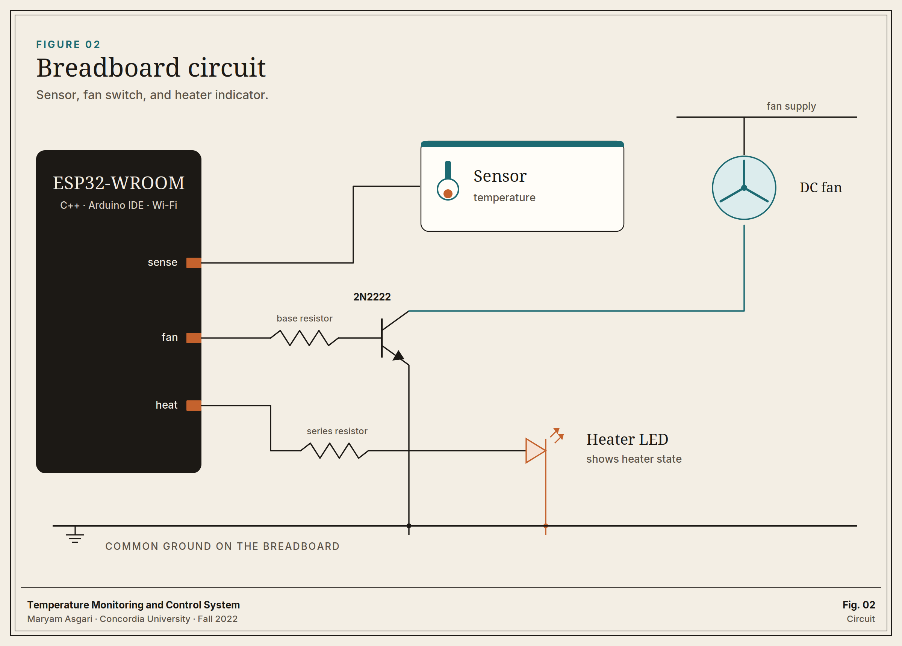
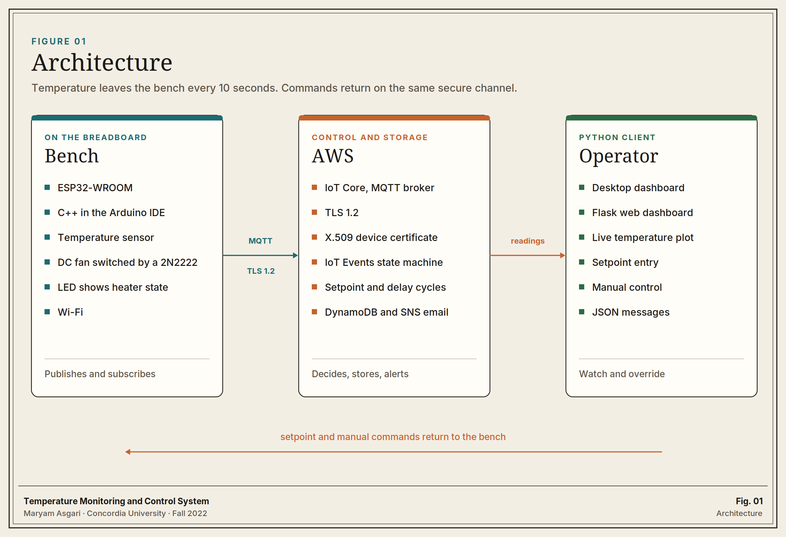
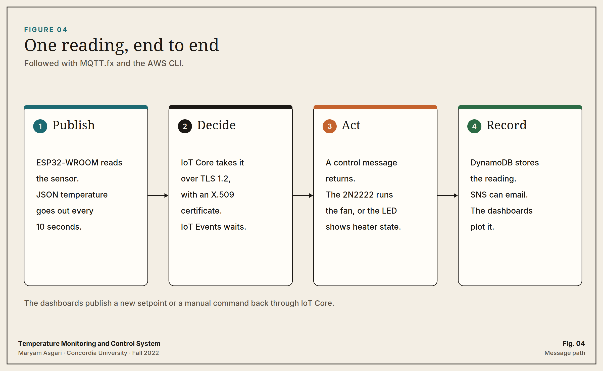

# Temperature Monitoring and Control System

**Maryam Asgari** · Concordia University · Fall 2022

Selected engineering project. A breadboard measures temperature, publishes it on a secure MQTT link, and takes fan and heater commands from a cloud state machine that refuses to chatter.

The microcontroller is an ESP32-WROOM, programmed in C++ with the Arduino IDE. A 2N2222 NPN transistor switches a DC fan. An LED shows heater state. Temperature goes out every 10 seconds as JSON, over Wi-Fi, MQTT, and TLS 1.2, with an X.509 certificate on the device. AWS IoT Events holds the setpoint and a delay cycle. DynamoDB stores the readings. SNS sends email. A Python client serves a desktop dashboard and a Flask page for the live plot, a new setpoint, and manual control.

## The bench

The sensor is read by the ESP32. The fan is the motor load: its supply sits on one side, and the 2N2222 low-side switch sits on the other, with a resistor into the base. The heater on this prototype is shown by an LED, so the command is visible on the board itself. Both the transistor emitter and the LED cathode return to the breadboard ground.

## Firmware

The firmware has two jobs on the MQTT session.

- Publish the temperature every 10 seconds.
- Subscribe to the control topics and drive the fan transistor and the heater LED from what comes back.

The payload is JSON. The session is authenticated with an X.509 certificate and protected with TLS 1.2.

## Cloud control

AWS IoT Core is the broker. IoT Events is the state machine. It compares each reading with the setpoint, then holds the decision for a delay cycle before the fan or the heater LED is allowed to change. That wait is what stops the actuators from flipping on every sample when the temperature sits on the boundary. Readings are stored in DynamoDB. SNS sends the email alert. Setpoint changes and manual commands travel back to the bench on the same channel.

Figure 3 is a drawing of that rule. In the shaded bands the temperature is already past the setpoint, and the actuator stays put until the delay has elapsed. After the wait, the fan runs if the bench is still warm, or the heater LED comes on if it is still cool.

## Dashboards

Two views share the Python MQTT client.

- A desktop dashboard.
- A Flask web dashboard with a live temperature plot, setpoint entry, and manual control.

Manual control is the override. The state machine remains the automatic path: setpoint, delay, then fan or heater LED.

## How it was tested

The path was exercised end to end with MQTT.fx and the AWS CLI. A temperature was published, IoT Events was watched through the delay, the control message was confirmed on the way back, and the stored reading and the email alert were checked.

## Technologies

ESP32-WROOM · C++ · Arduino IDE · Python · Flask · MQTT · Wi-Fi · TLS 1.2 · X.509 · AWS IoT Core · AWS IoT Events · DynamoDB · SNS · JSON

## Figures

| Figure | What it shows |
| --- | --- |
| [Circuit](docs/figures/circuit.png) | Sensor, 2N2222 fan switch, heater LED |
| [Architecture](docs/figures/architecture.png) | Bench, AWS, and the dashboards |
| [Control loop](docs/figures/control-loop.png) | Setpoint and delay cycle |
| [Message path](docs/figures/message-path.png) | One reading from the sensor to email and the plot |
