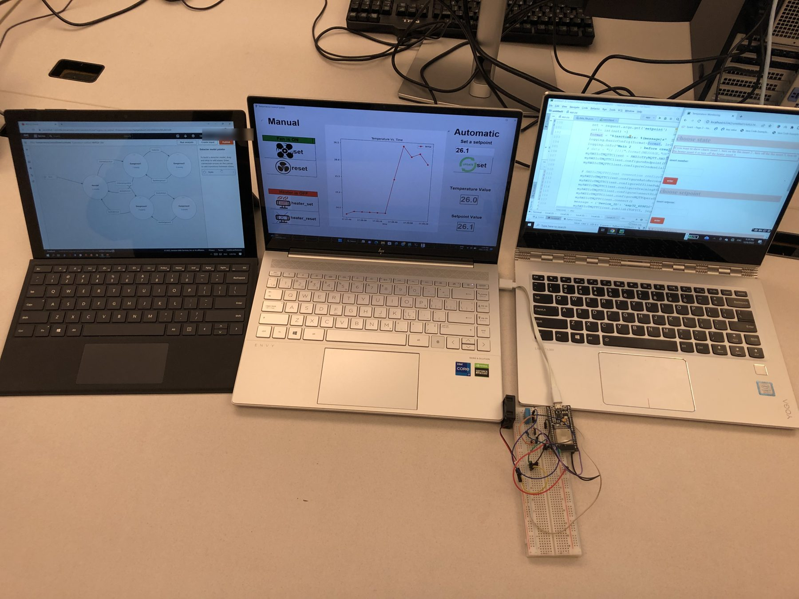
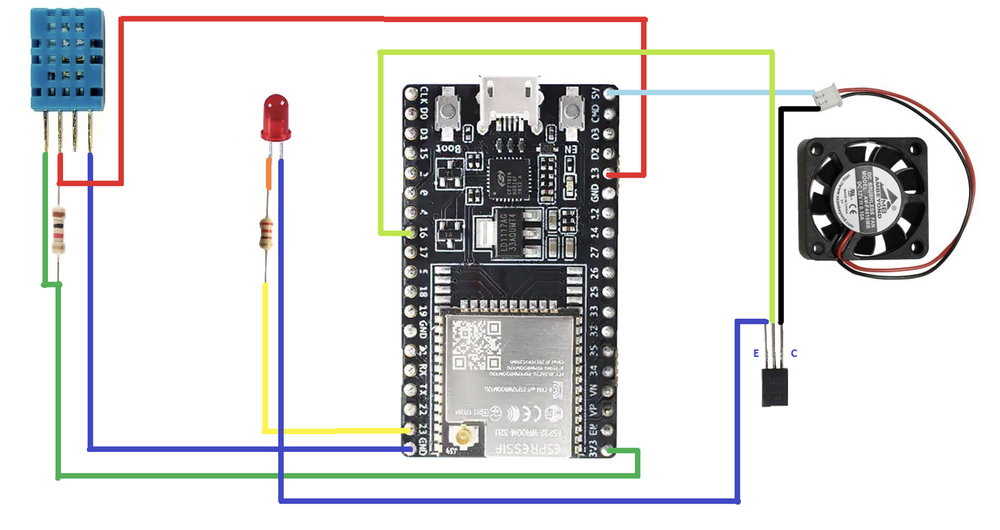
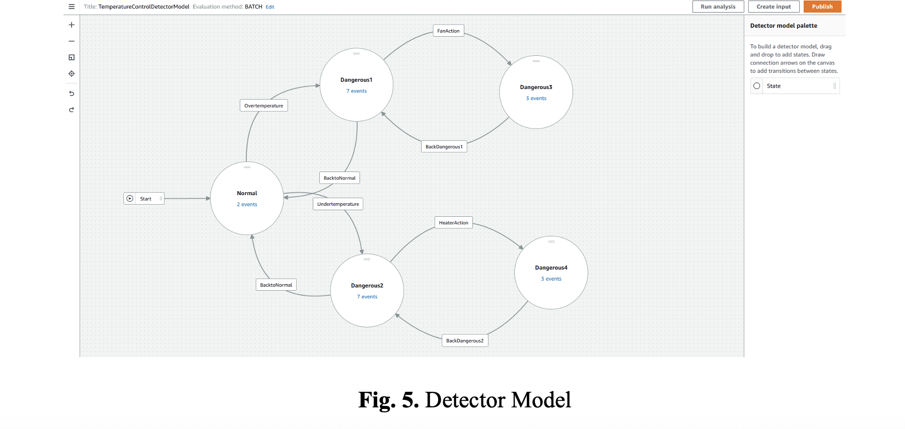
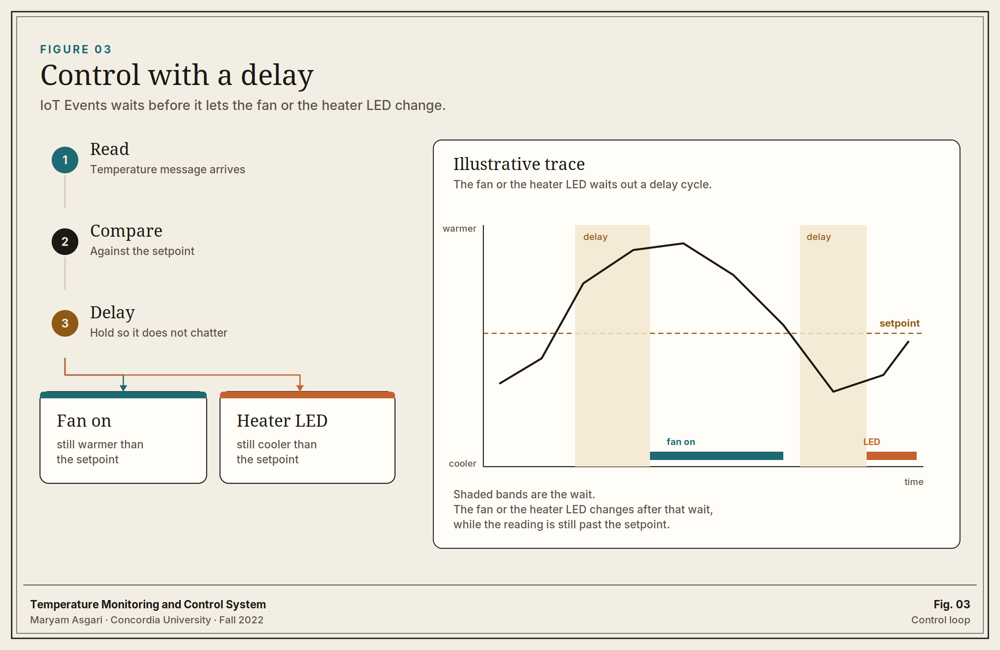
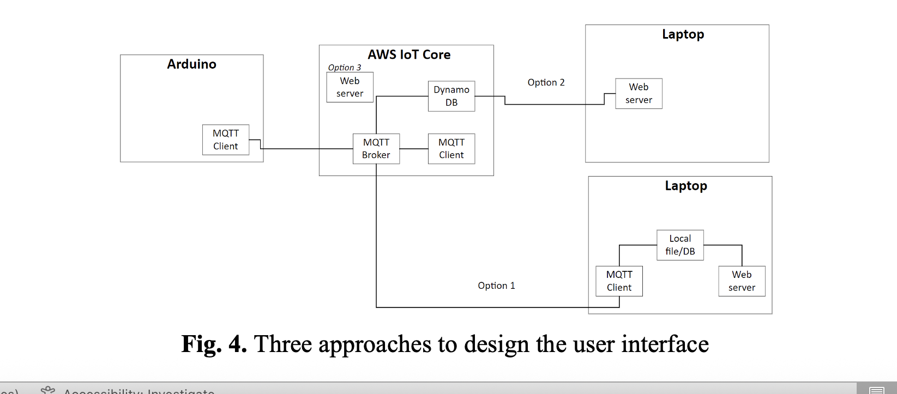

# Temperature Monitoring and Control System

**Maryam Asgari** · Concordia University · Fall 2022

Selected engineering project. A breadboard measures temperature, publishes it on a secure MQTT link, and takes fan and heater commands from an AWS IoT Events state machine.

The microcontroller is an ESP32-WROOM, programmed in C++ with the Arduino IDE. A 2N2222 NPN transistor switches a DC fan. An LED shows heater state. Temperature goes out every 10 seconds as JSON, over Wi-Fi, MQTT, and TLS 1.2, with an X.509 certificate on the device. IoT Events compares the reading with a setpoint and uses timed transitions so the fan and the heater LED do not chatter. DynamoDB stores the readings. SNS sends email. A Python client, built on the AWS IoT MQTT library, serves a desktop dashboard and a Flask page for the live plot, a new setpoint, and manual control.

## The demo



The photograph is the running demo. One screen has the IoT Events detector model, the middle screen has the desktop dashboard, and the right screen has the Python client (`app.py`) beside the Flask page. The breadboard with the ESP32 sits in front of the laptops.

## The bench



The report wiring shows the temperature sensor and the heater LED, each with a series resistor, on the ESP32 development board, and the DC fan switched by a small transistor. The LED is the heater-state indicator on the prototype, so the command is visible on the board.


## Desktop dashboard


The desktop window is titled Temperature Control System. The manual side turns the fan and the heater on and off directly (`set` / `reset`, `heater_set` / `heater_reset`) and shows whether each one is on. The automatic side takes a setpoint, and the plot in the middle is temperature against time. The same client also serves the Flask page, where an operator picks a state or types a setpoint.

## Detector model



The model is named TemperatureControlDetectorModel. From Normal it branches on over-temperature and under-temperature into danger-zone states, and those states run the fan action or the heater action. Transitions such as back-to-normal, back-to-fan, and back-to-heater close the loop. The extra states are the delay: the actuator is not allowed to flip on the sample that merely crosses the setpoint.



## Where the interface could run



The report compared three places to put the user interface. One keeps the MQTT client, a local database, and the web server on the laptop. One puts only the web server on the laptop and leaves IoT Core and DynamoDB in AWS. One moves the web server to the AWS side. The build used the cloud path: IoT Core, the detector model, DynamoDB, and the Python dashboards.


## How it was tested

The path was exercised end to end with MQTT.fx and the AWS CLI. A temperature was published, the detector model was watched through its transitions, the control message was confirmed on the way back, and the stored reading and the email alert were checked.

## Device code

The ESP32 program is in [`firmware/esp32_aws_iot/esp32_aws_iot.ino`](firmware/esp32_aws_iot/esp32_aws_iot.ino). It follows Appendix 1 and is filled in where the screenshots stopped.

The sketch reads a DHT11 on pin 13 and publishes this JSON on `outTopic` every 10 seconds:

```json
{"Device_ID":"esp32_609F1C","Fan":0,"Heater":0,"Flag1":1,"Flag2":0,"Temp":23.4}
```

`Fan` and `Heater` are the pin states. `Flag1` is `1` while AWS or a new setpoint is in charge, and `0` after a manual command. `Flag2` is cleared when a setpoint arrives, as in the appendix.

`inTopic` is the detector model. `mTopic` is the manual dashboard. Both accept `0` fan off, `1` fan on, `2` heater off, `3` heater on, either as a single character or as `{"message":"1"}`. The fan is pin 17. The heater LED is pin 23. `setTopic` accepts text such as `23.4` or `{"setpoint":23.4}`. The ESP32 stores that number. The delay and the decision to switch the fan or the heater stay in IoT Events.

Before flashing, put the Wi-Fi name, the Wi-Fi password, the AWS IoT endpoint, and the three certificate PEM strings into the constants at the top of the sketch. The report left those blank, and they are not stored here. The Python client and the Flask page are still not in this repo. The web form used a different numbering, `1` through `5`; the device contract is the `0` to `3` codes above, so the Python client has to translate.

## Technologies

ESP32-WROOM · C++ · Arduino IDE · Python · Flask · MQTT · Wi-Fi · TLS 1.2 · X.509 · AWS IoT Core · AWS IoT Events · DynamoDB · SNS · JSON

## Figures

| Figure | What it shows |
| --- | --- |
| [Demo](docs/figures/demo-bench.jpg) | The system running on the bench |
| [Circuit, from the report](docs/figures/report-circuit.png) | Sensor, LED, ESP32, fan, transistor |
| [Desktop UI](docs/figures/report-ui.png) | Manual control, live plot, setpoint |
| [Detector model](docs/figures/report-detector.png) | IoT Events states for fan and heater |
| [Interface options](docs/figures/report-ui-options.png) | Three places the dashboard could run |
