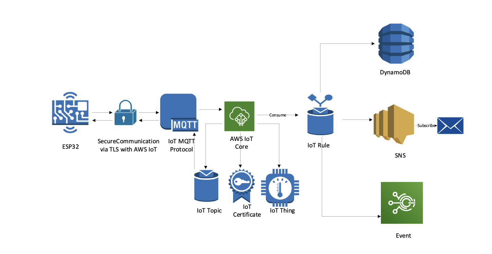
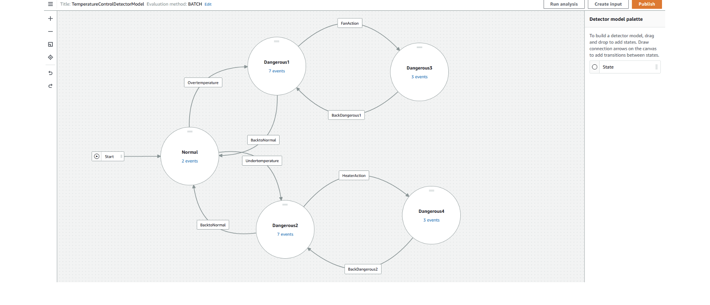
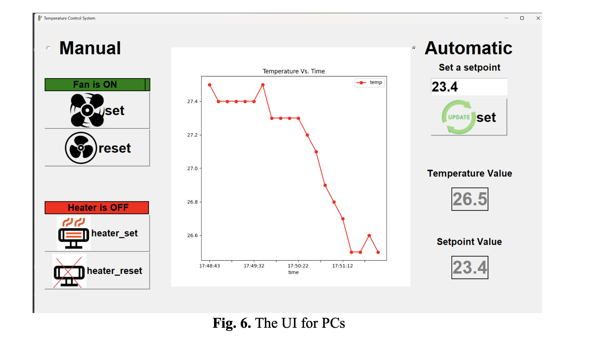

# Temperature Monitoring and Control System

**Maryam Asgari** · Concordia University · Fall 2022

## Project Overview

A cloud-based IoT system designed to monitor and control temperature remotely using ESP32, AWS cloud services, and the MQTT communication protocol.

The system supports real-time temperature monitoring, automated temperature control, manual device operation, data storage, and email notifications through desktop and web-based interfaces.

A breadboard measures temperature, publishes it on a secure MQTT link, and takes fan and heater commands from an AWS IoT Events state machine.

The microcontroller is an ESP32-WROOM, programmed in C++ with the Arduino IDE. A 2N2222 NPN transistor switches a DC fan. An LED shows heater state. Temperature goes out every 10 seconds as JSON, over Wi-Fi, MQTT, and TLS 1.2, with an X.509 certificate on the device. IoT Events compares the reading with a setpoint and uses timed transitions so the fan and the heater LED do not chatter. DynamoDB stores the readings. SNS sends email. A Python client, built on the AWS IoT MQTT library, serves a desktop dashboard and a Flask page for the live plot, a new setpoint, and manual control.

## Key Features

- Real-time temperature monitoring every 10 seconds
- Remote fan and heater control
- Automatic temperature regulation based on a user-defined setpoint
- Secure MQTT communication using TLS 1.2
- Cloud-based data storage using Amazon DynamoDB
- Event-driven automation using AWS IoT Events
- Email notifications using Amazon SNS
- Python-based desktop application

## System Architecture

The system integrates embedded hardware, cloud services, and user interfaces to enable remote monitoring and control.


### Data Flow

1. The DHT11 sensor measures the temperature.
2. ESP32 publishes sensor data to AWS IoT Core every 10 seconds.
3. AWS IoT Core processes incoming MQTT messages.
4. DynamoDB stores temperature measurements.
5. AWS IoT Events evaluates temperature conditions.
6. Control commands are transmitted back to the ESP32.
7. Desktop and web interfaces display system conditions and allow user interaction.

## Hardware Design

The hardware prototype consists of:

- ESP32-WROOM microcontroller
- DHT11 temperature sensor
- DC fan for cooling
- LED representing heater operation
- NPN transistor
- Resistors


The wiring shows the temperature sensor and the heater LED, each with a series resistor, on the ESP32 development board, and the DC fan switched by a small transistor. The LED is the heater-state indicator on the prototype, so the command is visible on the board.

## Control Logic

The system supports two operating modes.

### Automatic Mode

A cloud-based state machine evaluates the measured temperature against the desired setpoint.

- Temperature above setpoint: activate cooling.
- Temperature below setpoint: activate heating.
- Temperature at setpoint: return to normal mode after three stable measurement cycles.
- A five-cycle transition delay prevents immediate switching between heating and cooling.



### Manual Mode

Users can remotely control the fan and heater through the user interface without triggering automatic control logic.

## MQTT Communication

| Topic | Purpose |
|---|---|
| `outTopic` | Publish sensor telemetry |
| `inTopic` | Receive automatic control commands |
| `mTopic` | Receive manual control commands |
| `setTopic` | Receive setpoint-related messages |

## Cloud Implementation

- **AWS IoT Core:** Secure device connectivity and MQTT messaging.
- **AWS IoT Events:** State-machine-based temperature control.
- **Amazon DynamoDB:** Temperature data storage.
- **Amazon SNS:** Rule-based email notifications.
- **AWS IAM:** Access control and resource permissions.

Device authentication is implemented using certificates and encrypted TLS communication.

## User Interfaces

### Desktop Application

A Python-based graphical user interface developed using Tkinter and Matplotlib.

Features include:

- Real-time temperature visualization
- Temperature setpoint configuration
- Fan and heater status monitoring
- Manual and automatic operating modes
- Historical temperature visualization



### Web Dashboard

An HTML-based dashboard connected to a local Python MQTT client for remote monitoring and control.

The dashboard provides:

- Fan and heater control
- Temperature setpoint configuration
- Temperature visualization
- Fan and heater state visualization

## The demo


The photograph is the running demo. One screen has the IoT Events detector model, the middle screen has the desktop dashboard, and the right screen has the Python client (`app.py`) beside the Flask page. The breadboard with the ESP32 sits in front of the laptops.

## How it was tested

The path was exercised end to end with MQTT.fx and the AWS CLI. A temperature was published, the detector model was watched through its transitions, the control message was confirmed on the way back, and the stored reading and the email alert were checked.

## Device code

The ESP32 program is in [`firmware/esp32_aws_iot/esp32_aws_iot.ino`](firmware/esp32_aws_iot/esp32_aws_iot.ino). The sketch reads a DHT11 on pin 13 and publishes this JSON on `outTopic` every 10 seconds:

```json
{"Device_ID":"esp32_609F1C","Fan":0,"Heater":0,"Flag1":1,"Flag2":0,"Temp":23.4}
```

`Fan` and `Heater` are the pin states. `Flag1` is `1` while AWS or a new setpoint is in charge, and `0` after a manual command. `Flag2` is cleared when a setpoint arrives, as in the appendix.

`inTopic` is the detector model. `mTopic` is the manual dashboard. Both accept `0` fan off, `1` fan on, `2` heater off, `3` heater on, either as a single character or as `{"message":"1"}`. The fan is pin 17. The heater LED is pin 23. `setTopic` accepts text such as `23.4` or `{"setpoint":23.4}`. The ESP32 stores that number. The delay and the decision to switch the fan or the heater stay in IoT Events.

Before flashing, put the Wi-Fi name, the Wi-Fi password, the AWS IoT endpoint.

The dashboard section is in [`IoTDashboard`](IoTDashboard).

## Technologies and Tools

| Category | Technologies |
|---|---|
| Microcontroller | ESP32-WROOM |
| Sensor | DHT11 |
| Cloud Platform | Amazon Web Services (AWS) |
| Cloud Services | IoT Core, IoT Events, DynamoDB, SNS, IAM |
| Communication | MQTT, Wi-Fi, TLS 1.2 |
| Programming | C/C++, Python, HTML |
| Data Format | JSON |
| Visualization | Matplotlib, Tkinter, Pandas |
| Development Tools | Arduino IDE, AWS CLI, MQTT.fx |
